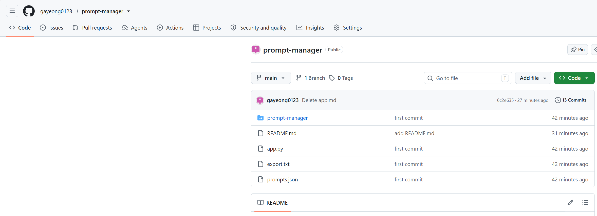

# 🚀 프롬프트 관리 콘솔 (Prompt Manager)

자주 사용하는 AI 프롬프트를 저장하고 관리하는 CLI(명령줄) 프로그램입니다.

## ✨ 주요 기능
- 추가: 제목, 내용, 태그와 함께 프롬프트 저장
- 목록 보기: 저장된 모든 프롬프트 확인
- 검색: 제목이나 내용으로 원하는 프롬프트 찾기
- 수정/삭제: ID를 기반으로 내용 관리
- 내보내기: 저장된 내용을 텍스트 파일로 추출
- 데이터 보존: JSON 파일을 통해 프로그램 종료 후에도 데이터 유지

## 🛠️ 사용 방법
1. 저장소를 복제(Clone)합니다.
2. 아래 명령어로 프로그램을 실행합니다.
   python app.py
3. 화면에 안내되는 번호(1~8)를 입력하여 기능을 사용합니다.

## 💻 개발 환경
- Python 3.14

## Git 설치 및 설정 확인

프로젝트 제출 전 Git이 정상적으로 설치되었는지, 그리고 사용자 정보가 올바르게 설정되었는지 확인했습니다.

### 1. Git 버전 확인
실행 명령어: `git --version`

결과: 'git version 2.56.1.windows.1'

### 2. Git 사용자 정보 확인
실행 명령어:
- `git config --global --get user.name`
- `git config --global --get user.email`

확인 결과:
- `user.name=gayeong0123`
- `user.email=kayeong3846@gmail.com`

## GitHub 저장소 및 업로드 확인

### 1. GitHub 저장소 URL
- 저장소 주소: https://github.com/gayeong0123/prompt-manager.git

### 2. 코드 업로드 확인
GitHub 저장소에 프로젝트 코드가 업로드된 화면입니다.


## 저장소 복제(Clone) 확인

### 1. clone 실행 명령어
실행 명령어: `git clone https://github.com/gayeong0123/prompt-manager.git`

### 2. 복제된 폴더 확인
아래는 복제 후 로컬 폴더에서 파일이 정상적으로 생성된 화면입니다.


## 프로그램 실행 및 기능 테스트

### 1. 프로그램 실행
실행 명령어: `python app.py`

프로그램을 실행하면 아래와 같이 메뉴가 표시됩니다.

--- 🚀 프롬프트 관리 콘솔 ---

새 프롬프트 추가
전체 목록 보기
프롬프트 검색
프롬프트 수정
프롬프트 삭제
카테고리/태그별 조회
텍스트 파일로 내보내기
종료
메뉴를 선택하세요 (1-8):

### 2. 기능별 테스트 결과

#### ① 프롬프트 추가 (메뉴 1)
제목, 내용, 카테고리, 태그를 입력하여 새 프롬프트를 저장합니다.

#### ② 전체 목록 보기 (메뉴 2)
저장된 모든 프롬프트를 ID 순서대로 출력합니다.

#### ③ 프롬프트 검색 (메뉴 3)
키워드를 입력하면 제목·내용에서 일치하는 항목을 찾아 표시합니다.

#### ④ 프롬프트 수정 (메뉴 4)
ID로 프롬프트를 선택한 뒤, 변경할 항목만 수정할 수 있습니다. (엔터 시 기존 값 유지)

#### ⑤ 프롬프트 삭제 (메뉴 5)
ID 입력 후 확인(y/n) 절차를 거쳐 삭제합니다.

#### ⑥ 카테고리/태그별 조회 (메뉴 6)
특정 카테고리나 태그로 프롬프트를 필터링하여 표시합니다.

#### ⑦ 텍스트 파일로 내보내기 (메뉴 7)
저장된 모든 프롬프트를 `.txt` 파일로 내보냅니다.

#### ⑧ 종료 (메뉴 8)
프로그램을 안전하게 종료합니다.

## 데이터 저장 구조

프롬프트는 `prompts.json` 파일에 아래와 같은 형식으로 저장됩니다.

```json
[
  {
    "id": 1,
    "title": "면접 자기소개",
    "content": "신입 개발자 면접 자기소개 예시 만들어줘",
    "category": "면접",
    "tags": ["자기소개", "면접", "신입"]
  }
]

폴더 구조
prompt-manager/
├── app.py           
├── prompts.json
├── export.txt
├── README.md
└── images/
    ├── image.png
    ├── image-1.png
    └── image-2.png

개발 과정에서 배운 점
Git을 활용한 버전 관리와 merge conflict 해결 방법을 익혔습니다.
JSON 파일을 이용해 데이터를 영구 저장하는 방법을 학습했습니다.
사용자 입력 검증과 예외 처리의 중요성을 체감했습니다.
메뉴 기반 콘솔 프로그램의 설계 흐름을 이해하게 되었습니다.

작성자
이름: gayeong0123
GitHub: https://github.com/gayeong0123